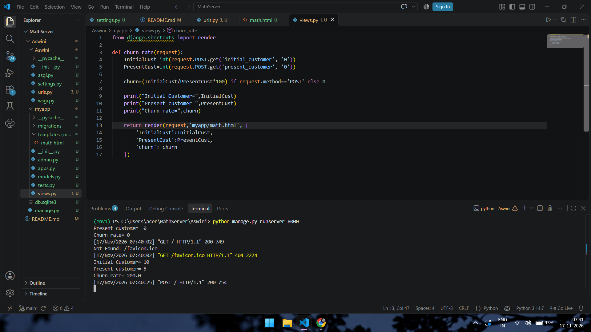
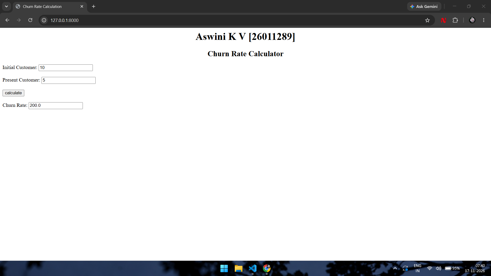

# Ex.03 Design a Website for Server Side Processing
## Date:16/11/2026

## AIM:
To create a web page to calculate Churn Rate using server-side scripts.

## FORMULA:
Churn Rate = (CustLost / InitCust) * 100
<br> InitCust --> Initial Customers Count
<br> CustLost --> Customers Lost Count

## DESIGN STEPS:

### Step 1:
Clone the repository from GitHub.

### Step 2:
Create Django Admin project.

### Step 3:
Create a New App under the Django Admin project.

### Step 4:
Create a HTML file to implement form based input and output.

### Step 5:
Create python programs for views and urls to perform server side processing.

### Step 6:
Receive input values from the form using request.POST.get().

### Step 7:
Calculate the Result using the given formula.

### Step 8:
Display the calculated result in the server console.

### Step 9:
Render the result to the HTML template.

### Step 10:
Publish the website in Localhost.

## PROGRAM:
```
math.html

<html>
<head>
    <title>Churn Rate Calculation</title>
</head>
<body>
    <h1 align="center">Aswini K V [26011289]</h1>
    <h2 align="center">Churn Rate Calculator</h2>

    <form method="POST">
        

        <label>Initial Customer:</label>
        <input type="number" name="initial_customer" value="{{InitialCust}}">
        <br><br>

        <label>Present Customer:</label>
        <input type="number" name="present_customer" value="{{PresentCust}}">
        <br><br>

        <input type="submit" value="calculate"><br><br>
        
        <label>Churn Rate:</label>
        <input type="number" value="{{churn}}"><br><br>
    </form>
</body>
</html>

view.py

from django.shortcuts import render

def churn_rate(request):
    InitialCust=int(request.POST.get('initial_customer', '0'))
    PresentCust=int(request.POST.get('present_customer', '0'))

    churn=(InitialCust/PresentCust*100) if request.method=='POST' else 0

    print("Intial Customer=",InitialCust)
    print("Present customer=",PresentCust)
    print("Churn rate=",churn)

    return render(request,'myapp/math.html', {
        'InitialCust':InitialCust,
        'PresentCust':PresentCust,
        'churn': churn
    })


urls.py

from django.contrib import admin
from django.urls import path
from myapp import views

urlpatterns = [path('', views.churn_rate, name='churn_rate'),]

```


## OUTPUT - SERVER SIDE:



## OUTPUT - WEBPAGE:


## RESULT:
The the web page to calculate Churn Rate using server-side scripts is created successfully.
